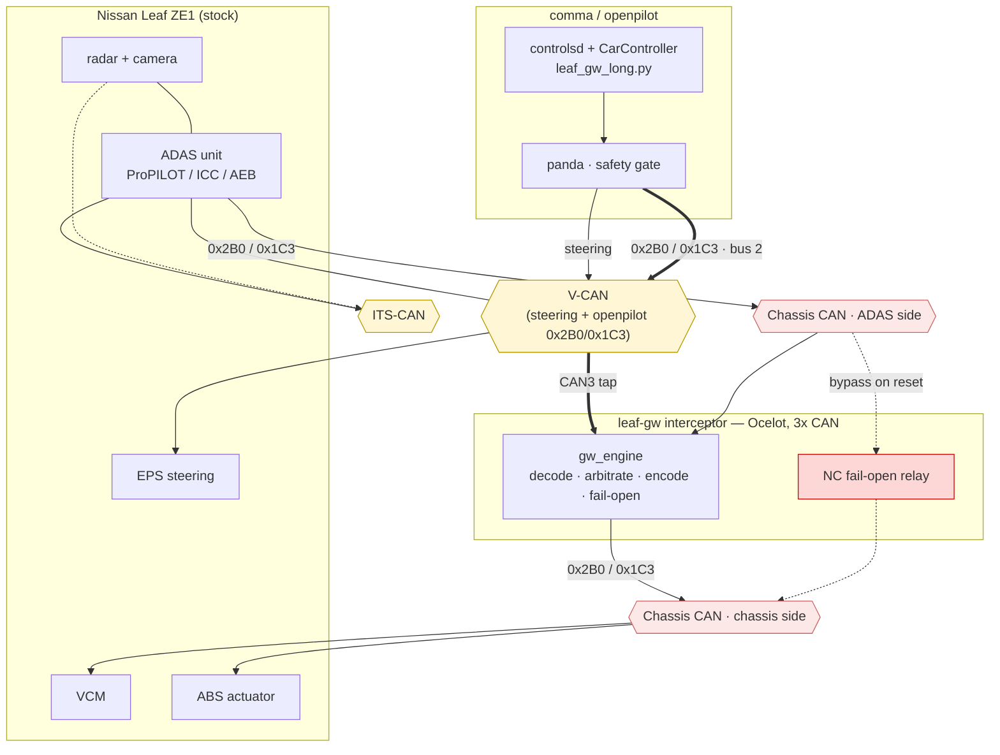
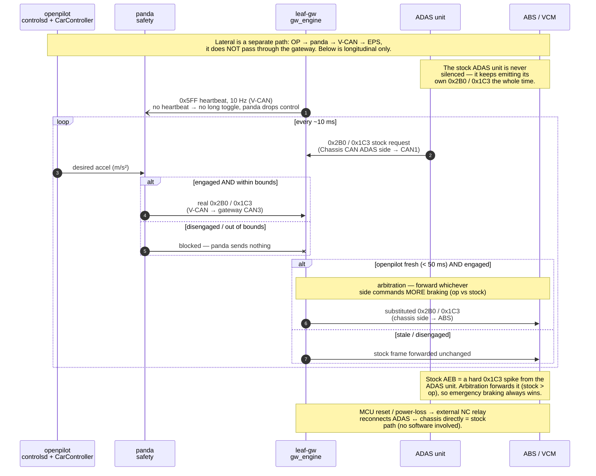
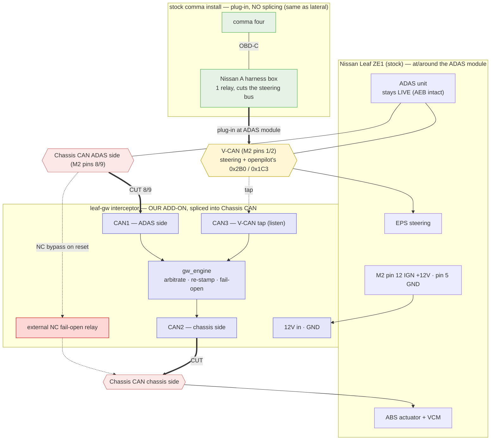

# leaf-gw

Decision core for an inline Chassis CAN **gateway** that adds openpilot longitudinal
(gas/brake) control to a 2018–2023 Nissan Leaf (ZE1) **without disabling the
car's stock emergency braking**.

> Bench and a dedicated test car only — never a daily driver. This touches the
> brake path.

## Architecture

The comma/openpilot device, its panda, and this interceptor are **not wired
together** — everything crosses as CAN frames. Thick = the openpilot command;
dotted = the hardware fail-open bypass. Source: [`docs/architecture.mmd`](docs/architecture.mmd).



That graph is the wiring *logically*. For **what happens over time** in one
engaged longitudinal cycle — who sends what, and the arbitration / fail-open
branches — the sequence chart (source: [`docs/sequence.mmd`](docs/sequence.mmd)):



And the **physical wiring** (planned — pins from the 2018 Leaf ESM, relay
topology functional; source: [`docs/wiring.mmd`](docs/wiring.mmd)). Green is the
**stock comma install** — the same plug-in Nissan A harness a lateral-only setup
uses, no splicing. Purple is **our add-on**: a box spliced into the Chassis CAN pair.
That splice is the entire wiring difference from a stock comma (and from
StarPilot, which is the stock harness + firmware only):



## How StarPilot does it, and why we don't silence

StarPilot has the one known Leaf-longitudinal implementation — but it's
**disabled** in the tree (`ALPHA_LONG_ENABLED = False`) and pinned to a single
2025 SV Plus camera firmware. It's one developer's experiment, not a shipped or
widely-run feature (StarPilot's public car list shows the Leaf for *steering*,
and says nothing about longitudinal). It still shows both that these frames
actuate on that car and why nobody kept AEB. On engage it opens a KWP2000 session
to the ADAS ECU (`0x707`) and sends *DisableNormalMessageTransmission* (`28 02`),
held open with tester-present, so the ADAS unit **goes mute**; openpilot then
transmits its own `0x2B0`/`0x1C3` on the chassis-side bus with no competing
transmitter.

That mutes **everything** the ADAS sends — including the emergency braking it
would command. No ADAS, no AEB. We reuse its accel→frame math, but treat the
numbers as a lightly-proven starting point (see the caveat below), and we do
**not** silence anything.

Instead the ADAS stays live (AEB included) and the in-line gateway **arbitrates**
per frame — dropping the ADAS's `0x2B0`/`0x1C3` only when openpilot asks for more
braking, re-stamping the stock counter so the stream stays valid. A plain
comma-harness-plus-panda can't do that (it can only add frames, not replace a
running counter-stream), which is the whole reason this is a separate in-line box
rather than a pure openpilot port.

## Why the frames are inert without the gateway

openpilot emits the real `0x2B0`/`0x1C3` on V-CAN, but on the ZE1 those ADAS
actuation signals live on **Chassis CAN** — a bus the comma harness only *listens*
to, never injects onto. So a `0x2B0`/`0x1C3` sent on a comma-accessible bus
reaches no actuator; only this interceptor, spliced into Chassis CAN, can relay them
to the ABS/VCM. Hence:

- stock car, or interceptor absent / dead → the frames go nowhere (inert);
- the gateway is the *enabling* piece, not an optimization.

Independent support: Nissan's own gateway forwarding table (published in
PCAutomotive's Black Hat Asia 2025 Leaf talk) forwards only diagnostic and a few
status IDs between buses (`0x49F`, `0x620-0x621`, `0x6FA`, `0x700-0x7FF`, …) —
`0x2B0`/`0x1C3` are not forwarded, so the car's gateway won't bridge them to the
actuators either.

That is also why mainline openpilot has no Leaf longitudinal: the only known way
to actuate was to silence the ADAS ECU and transmit on a bus that reaches the
brakes (StarPilot) — which kills AEB. This gateway actuates by splicing Chassis CAN
instead, so stock AEB stays.

**Safety gate:** across 37 cars, stock `0x2B0`/`0x1C3` show up only on panda
bus 1, never on bus 2, so nothing stock competes with openpilot's frames there.
That doesn't prove an injected frame is inert: "inert" is a property of the
*bus*, not the frame, and StarPilot proves these IDs bite on a bus that reaches
the ABS. So confirm the V-CAN segment
we transmit on is listen-only: with the interceptor absent, inject `0x2B0`/`0x1C3`
there and verify **no actuation** and that **nothing crosses to Chassis CAN**. (Same
bench step as pinning which V-CAN segment is panda bus 2.)

## What's here

`leaf_gw.c` / `leaf_gw.h` — pure, hardware-independent logic, host-testable:

- decode/encode of the two ADAS request frames, `0x2B0` (propulsion/regen → VCM)
  and `0x1C3` (friction brake → ABS actuator), plus the `0x1C3` checksum and
  `0x2B0` inverse-copy validation;
- `leaf_mode()` — fail-open state: `ACTIVE` only while engaged and an openpilot
  command arrived within the timeout; otherwise `PASSTHROUGH` (stock);
- magnitude arbitration — the gateway never silences the ADAS unit, so the stock
  request stays live; `leaf_arb_*` forward whichever side commands more braking
  and always yield to a stronger stock request. That is how stock AEB survives.
- the gateway **heartbeat** (`0x5FF`, 10 Hz, sent on the V-CAN port): openpilot
  only offers longitudinal when it sees it at startup, and panda drops control if
  it stops, so openpilot can't think it is driving when no gateway is inline.

```
make test
```

## Nix

```
nix flake check                 # C core + both Python suites + the Ocelot firmware build
nix build                       # build + host-test the core
nix build .#ocelot-firmware     # the signed panda/Ocelot image (leaf_gw.bin.signed, .elf, .bin)
echo '(0) can0 1C3#000000006400FF27' | nix run .   # phase-0 validator on a candump log
nix develop                     # host dev shell (gcc, make, python+numpy)
nix develop .#panda             # arm-none-eabi + scons, to build the Ocelot backend by hand
nix develop .#openpilot         # python 3.12 + opendbc test deps, to run the car/safety patches
```

`nix build .#ocelot-firmware` is a sealed, offline build: it pulls the RetroPilot
ocelot tree (a pinned flake input), drops this repo's `backends/panda/` + the core
into it, registers the scons project and signs with the debug cert.

## openpilot side

`openpilot/` has the car-side piece: an opendbc `car/nissan` patch that, with longitudinal enabled, emits the car's **real** `0x2B0`/`0x1C3` frames on V-CAN (panda bus 2) — no ECU silencing, no cruise spoofing, so stock AEB stays. The inline gateway reads them off V-CAN and re-emits onto Chassis CAN with magnitude arbitration. panda bounds the frames with the standard longitudinal safety helpers. `leaf_gw_long.py` is the dependency-free mapping/packer spec (host-tested, `python3 openpilot/test_leaf_gw_long.py`); the patches wire it into opendbc. See `openpilot/README.md`.

## What's NOT here (by design)

- The firmware CAN forwarding loop (that's `backends/panda/`, built against an
  Ocelot tree — see `nix build .#ocelot-firmware`).
- The **hardware normally-closed fail-open relay** that reconnects ADAS-side
  Chassis CAN straight to the chassis side when the MCU is unpowered/reset. Software
  cannot provide power-loss fail-open; the relay is mandatory.

Those are integration + hardware and are not unit-testable on a host.

## Big caveat

The `0x2B0`/`0x1C3` layouts started from StarPilot's **disabled, firmware-pinned
2025-SV-Plus experiment**. Stock logs from two ZE1s now pin down the layout; the
**scaling** (counts per m/s², brake pressure units) is still StarPilot's and
unverified, and nothing has been transmitted to a car.

- **Public route** `44211d9f2879657d/00000024--ddf4161f21` (US `NISSAN_LEAF_IC`,
  sunnypilot, stock ICC engaged 61% of the time; 4 segments, 23,959 frames of
  each id on bus 1): every `0x1C3` checksum and every `0x2B0` inverse copy
  validates. The `0x2B0` value's two low nibbles are **swapped** relative to
  StarPilot's packer: `V = b1_hi<<8 | b2_lo<<4 | b1_lo` (= `~(b2_hi<<8 | b0)`).
  That order is smooth (p99 frame-to-frame step 6 counts); StarPilot's jumps
  (p99 239). Everything here now uses the corrected order; the idle, neutral and
  brake-marker bytes are unchanged, only their decoded numbers moved (idle 5260,
  brake marker 2398).
- The **brake marker** (`a827d5…09`, value 2398) appears only while the friction
  brake is applied (822 of 835 frames with `0x1C3` pressure > 0); every other
  active value is 4096..8191. So it is a state, not a big decel on the same scale.
- **SHIOKAZE** (openpilot Discord, 2026-11-24; receive-only logs from a June 2022
  Japanese-spec ZE1 e+ G, bus 1 via the Nissan IC harness): independently
  confirmed the `0x1C3` field and checksum, spotted the `0x2B0` discontinuity and
  the 2518-is-a-state pattern, and found `0x707` `28 02` refused (`7F 28 11`), so
  StarPilot's silencing route doesn't work on that car.
- **Fleet check** (comma's public [commaCarSegments](https://huggingface.co/datasets/commaai/commaCarSegments)
  dataset; 3 segments from each of 31 Nissan A-harness and 6 IC-harness Leafs,
  106 segments, 635k frames of each id): zero checksum / inverse-copy failures,
  the corrected `0x2B0` order is smooth in every segment, and the brake marker
  bytes are identical everywhere. Stock `0x2B0`/`0x1C3` appear **only on bus 1**,
  on both harnesses, never on bus 0 or 2, so stock never competes with
  openpilot's frames on bus 2. `0x5FF` never appears on any bus, so the
  heartbeat id is free.
- **What stock braking looks like.** The highest `0x1C3` pressures (680–821) are
  all ICC's standstill hold: the car stops, `0x2B0` goes to the brake marker,
  `0x1C3` ramps at ~280 counts/s, and ICC releases a few seconds later. The
  strongest braking while moving was a sudden ICC brake at 68 km/h (0 → 556 in
  under a second, about −2 m/s²) that ended when the driver pressed the
  accelerator. Arbitration handles both (stock is stronger, so stock wins); no
  AEB event is in the sample.
- **Scaling, from the same data, is unresolved.** Fitting measured acceleration
  (wheel speed) to the stock command during ICC gives correlation 0.42. The
  extremes roughly match StarPilot (about −0.8 / +0.8 m/s² at 4096 / 8191), but
  steady cruise sits near 6,900 at every speed and a 5,120–5,631 cluster averages
  about 0 m/s², so the value behaves more like a limit or torque-style request
  than an acceleration target. It needs an active test on the bench or a test car.
- Still open: a handful of big jumps remain (e.g. `0x600 → 0x7FF` at engage), and
  whether `0x1C3` is total or friction-only braking.

Check your own car with the read-only validator `tools/leaf_iccan_check.py`:
capture Chassis CAN (panda + Cabana, USB-CAN, or `candump`) and feed it the log.
It checks the `0x1C3` checksum, the `0x2B0` inverse copy, and that the `0x2B0`
value moves smoothly (a swapped bit order passes the inverse copy but not that).

Our test car (2018 SL, 40 kWh), ECU part/version from Leaf Spy: FRONT CAMERA
`28438`/`5SA0A`, RADAR `28438`/`5SA0C`, ABS `47660`/`5SA0A`, BRAKE `47880`/`5SA1B`,
MOTOR CONTROL `292C0`/`5SA1A`. Leaf Spy's short version codes are probably a
different identifier from StarPilot's `6WK2CDB` camera pin, so the mismatch proves
nothing.

## License

MIT (see `LICENSE`), so the openpilot community can reuse it freely and because
the CAN message formats derive from MIT opendbc/StarPilot. Credits in
`ATTRIBUTION.md`.
