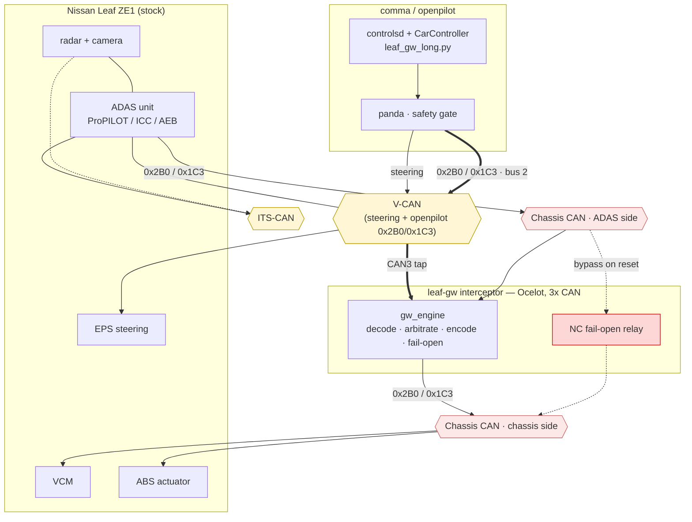
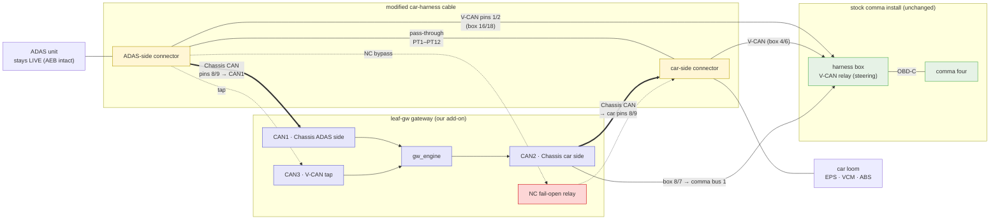

# leaf-gw

Decision core for an inline Chassis CAN **gateway** that adds openpilot longitudinal
(gas/brake) control to a 2018–2023 Nissan Leaf (ZE1) **without disabling the
car's stock emergency braking**.

> Bench and a dedicated test car only — never a daily driver. This touches the
> brake path.

## Architecture

The comma/openpilot device, its panda, and this interceptor are **not wired
together** — everything crosses as CAN frames. Thick = the openpilot command;
dotted = the hardware fail-open bypass. Source: [`docs/architecture.mmd`](docs/architecture.mmd).



That graph is the wiring *logically*. For **what happens over time** in one
engaged longitudinal cycle — who sends what, and the arbitration / fail-open
branches — the sequence chart (source: [`docs/sequence.mmd`](docs/sequence.mmd)):


And the **physical wiring** (planned; source: [`docs/wiring.mmd`](docs/wiring.mmd)).
It builds on comma's own Nissan A car harness, which plugs in between the ADAS
unit and the car loom and already brings the two halves of Chassis CAN out on
separate wire pairs; the harness box normally just joins them. The gateway sits
in that join, on a modified car-harness cable. The car's wiring is never cut,
the harness box and comma stay stock, and swapping the original cable back
undoes it. Pins and build steps are in [`HARDWARE.md`](HARDWARE.md):



## How StarPilot does it, and why we don't silence

StarPilot has the one known Leaf-longitudinal implementation — but it's
**disabled** in the tree (`ALPHA_LONG_ENABLED = False`) and pinned to a single
2025 SV Plus camera firmware. It's one developer's experiment, not a shipped or
widely-run feature (StarPilot's public car list shows the Leaf for *steering*,
and says nothing about longitudinal). It still shows both that these frames
actuate on that car and why nobody kept AEB. On engage it opens a KWP2000 session
to the ADAS ECU (`0x707`) and sends *DisableNormalMessageTransmission* (`28 02`),
held open with tester-present, so the ADAS unit **goes mute**; openpilot then
transmits its own `0x2B0`/`0x1C3` on the chassis-side bus with no competing
transmitter.

That mutes **everything** the ADAS sends — including the emergency braking it
would command. No ADAS, no AEB. We reuse its accel→frame math, but treat the
numbers as a lightly-proven starting point (see the caveat below), and we do
**not** silence anything.

Instead the ADAS stays live (AEB included) and the in-line gateway **arbitrates**
per frame — dropping the ADAS's `0x2B0`/`0x1C3` only when openpilot asks for more
braking, re-stamping the stock counter so the stream stays valid. A plain
comma-harness-plus-panda can't do that (it can only add frames, not replace a
running counter-stream), which is the whole reason this is a separate in-line box
rather than a pure openpilot port.

## Why the frames are inert without the gateway

openpilot emits the real `0x2B0`/`0x1C3` on V-CAN, but on the ZE1 those ADAS
actuation signals live on **Chassis CAN** — a bus the comma harness only *listens*
to, never injects onto. So a `0x2B0`/`0x1C3` sent on a comma-accessible bus
reaches no actuator; only this interceptor, spliced into Chassis CAN, can relay them
to the ABS/VCM. Hence:

- stock car, or interceptor absent / dead → the frames go nowhere (inert);
- the gateway is the *enabling* piece, not an optimization.

Independent support: Nissan's own gateway forwarding table (published in
PCAutomotive's Black Hat Asia 2025 Leaf talk) forwards only diagnostic and a few
status IDs between buses (`0x49F`, `0x620-0x621`, `0x6FA`, `0x700-0x7FF`, …) —
`0x2B0`/`0x1C3` are not forwarded, so the car's gateway won't bridge them to the
actuators either.

That is also why mainline openpilot has no Leaf longitudinal: the only known way
to actuate was to silence the ADAS ECU and transmit on a bus that reaches the
brakes (StarPilot) — which kills AEB. This gateway actuates by splicing Chassis CAN
instead, so stock AEB stays.

**Safety gate:** across 37 cars, stock `0x2B0`/`0x1C3` show up only on panda
bus 1, never on bus 2, so nothing stock competes with openpilot's frames there.
That doesn't prove an injected frame is inert: "inert" is a property of the
*bus*, not the frame, and StarPilot proves these IDs bite on a bus that reaches
the ABS. So confirm the V-CAN segment
we transmit on is listen-only: with the interceptor absent, inject `0x2B0`/`0x1C3`
there and verify **no actuation** and that **nothing crosses to Chassis CAN**. (Same
bench step as pinning which V-CAN segment is panda bus 2.)

## What's here

`leaf_gw.c` / `leaf_gw.h` — pure, hardware-independent logic, host-testable:

- decode/encode of the two ADAS request frames, `0x2B0` (propulsion/regen → VCM)
  and `0x1C3` (friction brake → ABS actuator), plus the `0x1C3` checksum and
  `0x2B0` inverse-copy validation;
- `leaf_mode()` — fail-open state: `ACTIVE` only while engaged and an openpilot
  command arrived within the timeout; otherwise `PASSTHROUGH` (stock);
- magnitude arbitration — the gateway never silences the ADAS unit, so the stock
  request stays live; `leaf_arb_*` forward whichever side commands more braking
  and always yield to a stronger stock request. That is how stock AEB survives.
- the gateway **heartbeat** (`0x5FF`, 50 Hz, sent on the V-CAN port): openpilot
  only offers longitudinal when it sees it at startup, and panda drops control if
  it stops, so openpilot can't think it is driving when no gateway is inline.

```sh
make test
```

## Nix

```sh
nix flake check                 # C core + both Python suites + the Ocelot firmware build
nix build                       # build + host-test the core
nix build .#ocelot-firmware     # the signed panda/Ocelot image (leaf_gw.bin.signed, .elf, .bin)
echo '(0) can0 1C3#000000006400FF27' | nix run .   # phase-0 validator on a candump log
nix develop                     # host dev shell (gcc, make, python+numpy)
nix develop .#panda             # arm-none-eabi + scons, to build the Ocelot backend by hand
nix develop .#openpilot         # python 3.12 + opendbc test deps, to run the car/safety patches
nix develop .#hardware          # the board (hardware/board): KiCad, SKiDL, freerouting
nix develop .#enclosure         # the case (hardware/enclosure): .#hardware plus OrcaSlicer, gmsh
```

`nix build .#ocelot-firmware` is a sealed, offline build: it pulls the RetroPilot
ocelot tree (a pinned flake input), drops this repo's `backends/panda/` + the core
into it, registers the scons project and signs with the debug cert.

## openpilot side

`openpilot/` has the car-side piece: an opendbc `car/nissan` patch that, with longitudinal enabled, emits the car's **real** `0x2B0`/`0x1C3` frames on V-CAN (panda bus 2) — no ECU silencing, no cruise spoofing, so stock AEB stays. The inline gateway reads them off V-CAN and re-emits onto Chassis CAN with magnitude arbitration. panda bounds the frames with the standard longitudinal safety helpers. `leaf_gw_long.py` is the dependency-free mapping/packer spec (host-tested, `python3 openpilot/test_leaf_gw_long.py`); the patches wire it into opendbc. See `openpilot/README.md`.

## What's NOT here (by design)

- The firmware CAN forwarding loop (that's `backends/panda/`, built against an
  Ocelot tree — see `nix build .#ocelot-firmware`).
- The **hardware normally-closed fail-open relay** that reconnects ADAS-side
  Chassis CAN straight to the chassis side when the MCU is unpowered/reset. Software
  cannot provide power-loss fail-open; the relay is mandatory.

Those are integration + hardware and are not unit-testable on a host.

## Big caveat

The `0x2B0`/`0x1C3` layouts started from StarPilot's **disabled, firmware-pinned
2025-SV-Plus experiment**. Stock logs from 38 ZE1s have since replaced most of
it: the `0x2B0` value field, its direction and a provisional accel scale now come
from stock data. Brake pressure scaling is still StarPilot's and unverified, and
nothing has been transmitted to a car.

- **The `0x2B0` value is T = `(b2 << 4) | (b1 & 0xF)`**, a 12-bit field whose
  inverted copy sits in `b1_hi:b0`. **Higher T = more deceleration.** StarPilot's
  packer scrambled it, so its accel map was meaningless for most of its range
  (its "0 m/s²" lands at T 2304, about +0.6 m/s²). Found in two steps: the public
  US route showed the low nibbles out of order, then SHIOKAZE showed the top nibble
  was inverted too. On ~755k frames from 38 cars the inverted copy holds on every
  frame and T moves smoothly (mean step 0.18 counts; big jumps are engage/idle
  transitions).
- **Stock values:** idle / inactive T = 2595 (`dc 53 a2 .. 1b .. 03`), the
  friction-brake marker T = 3415 (`a8 27 d5 .. 5b .. 09`, only while `0x1C3`
  pressure > 0: 822 of 835 frames on the US route, 8,718 of 8,718 on SHIOKAZE's
  car), and active values in 2048..3071. "More braking" is simply the larger T,
  marker included, which is what the gateway's arbitration uses.
- **Byte 3 is a state field.** Its low nibble is always `0xC`; the top three bits
  vary (`ac`, `8c` in Park, `6c`, `4c`, …) across all cars. The gateway keeps
  stock's byte 3 when it substitutes. Bit `0x20` tracks "cruise available"
  (openpilot's `CRUISE_THROTTLE.CRUISE_AVAILABLE`): SHIOKAZE found it on their
  car, and it agrees on 99.95% of the fleet sample's 755k frames, the rest at
  on/off transitions. Byte 4 bit `0x40` is "engaged and moving".
- **`0x180` follows T about 160 ms later** (SHIOKAZE): a signed 12-bit value in
  byte 2 and byte 3's top nibble, D ≈ −0.796·T + 2067. On the fleet sample it is
  on panda **bus 0** for Nissan A cars, and the best segments fit D = −0.798·T +
  2070 at correlation −0.999 (RMSE 1.1); the median segment's RMSE is 8, and it
  departs when something else (pedal, friction brake) drives the car. Whether it's
  the VCM's actual response or just a reflection of the request is open, but
  since the comma can read it directly, the openpilot patches use it as a
  follow check: if the car slows less than openpilot asked for 1 s, openpilot
  disengages (see `openpilot/README.md`).
- **Accel scale (provisional):** fitting acceleration measured from wheel speed to
  T during ICC, across the 37-car sample, gives correlation −0.76. Zero is near
  T ≈ 2530, about +0.8 m/s² at 2272 and −0.8 at 2784, flatter in between. The
  openpilot mapping interpolates those medians. It needs an active bench or
  test-car check before anyone relies on it.
- **Public route** `44211d9f2879657d/00000024--ddf4161f21` (US `NISSAN_LEAF_IC`,
  sunnypilot, stock ICC engaged 61% of the time; 23,959 frames of each id on
  bus 1): every `0x1C3` checksum and every `0x2B0` inverse copy validates.
- **SHIOKAZE** (openpilot Discord, 2026-11-24; receive-only logs from a June 2022
  Japanese-spec ZE1 e+ G, bus 1 via the Nissan IC harness): independently
  confirmed the `0x1C3` field and checksum, worked out the `0x2B0` value field
  (T), the brake-marker state and that `b4 & 0x40` means engaged and moving, and
  found `0x707` `28 02` refused (`7F 28 11`), so StarPilot's silencing route
  doesn't work on that car.
- **Fleet check** (comma's public [commaCarSegments](https://huggingface.co/datasets/commaai/commaCarSegments)
  dataset; 3 segments from each of 31 Nissan A-harness and 6 IC-harness Leafs,
  106 segments, 635k frames of each id): zero checksum / inverse-copy failures,
  and the brake marker bytes are identical everywhere. Stock `0x2B0`/`0x1C3` appear **only on bus 1**,
  on both harnesses, never on bus 0 or 2, so stock never competes with
  openpilot's frames on bus 2. `0x5FF` never appears on any bus, so the
  heartbeat id is free.
- **What stock braking looks like.** The highest `0x1C3` pressures (680–821) are
  all ICC's standstill hold: the car stops, `0x2B0` goes to the brake marker,
  `0x1C3` ramps at ~280 counts/s, and ICC releases a few seconds later. The
  strongest braking while moving was a sudden ICC brake at 68 km/h (0 → 556 in
  under a second, about −2 m/s²) that ended when the driver pressed the
  accelerator. Arbitration handles both (stock is stronger, so stock wins); no
  AEB event is in the sample.
- Still open: the brake pressure scaling, whether `0x1C3` is total or
  friction-only braking, and what byte 3's state bits and byte 7's 2-bit field
  mean.

Check your own car with the read-only validator `tools/leaf_iccan_check.py`:
capture Chassis CAN (panda + Cabana, USB-CAN, or `candump`) and feed it the log.
It checks the `0x1C3` checksum, the `0x2B0` inverse copy, and that the `0x2B0`
value moves smoothly (a wrong bit order can pass the inverse copy but not that).

Our test car (2018 SL, 40 kWh), ECU part/version from Leaf Spy: FRONT CAMERA
`28438`/`5SA0A`, RADAR `28438`/`5SA0C`, ABS `47660`/`5SA0A`, BRAKE `47880`/`5SA1B`,
MOTOR CONTROL `292C0`/`5SA1A`. Leaf Spy's short version codes are probably a
different identifier from StarPilot's `6WK2CDB` camera pin, so the mismatch proves
nothing.

## License

MIT (see `LICENSE`), so the openpilot community can reuse it freely and because
the CAN message formats derive from MIT opendbc/StarPilot. Credits in
`ATTRIBUTION.md`.
