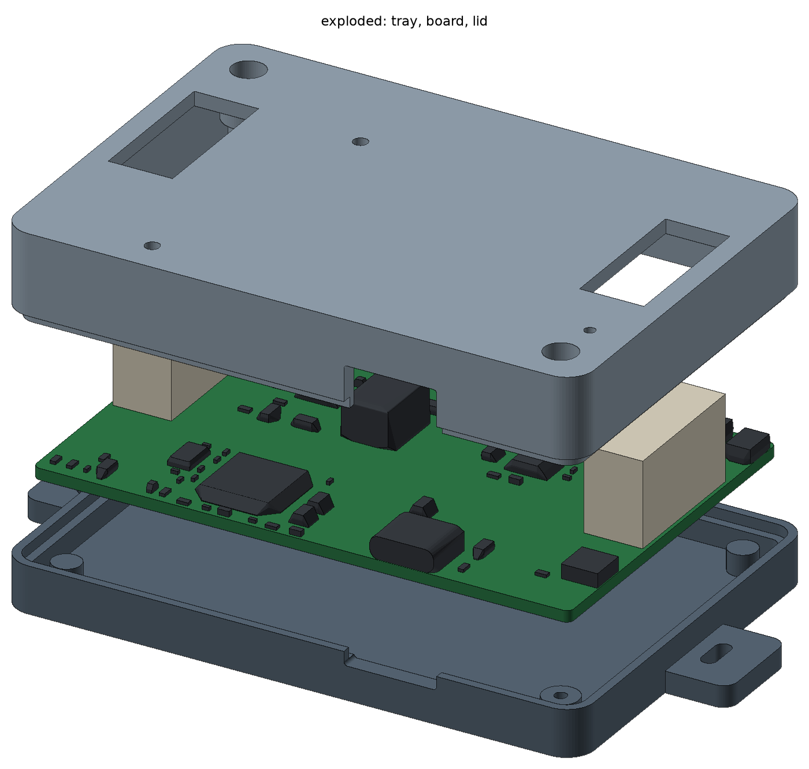

# leaf-gw enclosure

The case from [SPEC.md](../board/SPEC.md) phase 6: a 3D-printed bottom tray
and lid, generated by code from the board's own files and checked by code.
Nobody reviews the case by eye, so, as for the board, the checks are the
review, and each check has a mutation test that proves it fails on a broken
case.



## Files

| path | what |
|---|---|
| `case.py` | builds the tray and lid (manifold3d CSG); every dimension is a named parameter at the top with a one-line reason |
| `board3d.py` | the populated board as solids: outline, holes, header and button bodies, pin tails, and the convex hull of each part's KiCad 3D model |
| `checks.py` | the geometry checks (below) |
| `test_mutations.py` | breaks the case on purpose; each check must catch its mutation |
| `slicer.py` | print profiles, the 3MF projects, and the slicing check (OrcaSlicer CLI) |
| `render.py` | the PNG renders (a small z-buffer rasterizer, no GPU) |
| `check.sh` | runs every stage (`enclosure` flake check) |
| `out/tray.stl`, `out/lid.stl` | each part on its print orientation |
| `out/leaf-gw-case-{asa,abs,petg}.3mf` | both parts on one Bambu Lab H2D plate, with that material's profile |
| `out/board_parts.json` | part hulls exported from KiCad's 3D models (450 MB, so the checks use this file) |
| `out/render/` | `assembled.png`, `exploded.png`, `tray-printed.png`, `lid-printed.png` |

`out/` is generated, but committed; the checks fail if the STLs or 3MFs are
stale.

## Running

```bash
nix develop .#enclosure --command ./hardware/enclosure/check.sh            # check
nix develop .#enclosure --command ./hardware/enclosure/check.sh --update   # after editing case.py or the board
nix flake check                                                            # includes enclosure (no slicer, no plug)
```

`.#enclosure` is `.#hardware` plus `orca-slicer` and `gmsh`. Under
`.#hardware` or in the flake check, the slicer and harness-plug stages skip
and say so. The slicer is heavy, so the flake check leaves it out.

## The design

Outside, the case body is 80.8 × 55.8 × 18.1 mm, and 98.8 mm long over the
zip-tie ears. The tray is 6.6 mm tall and the lid 12.8 mm. The walls are
2.4 mm and the floor and roof 2.0 mm.

- **Tray.** The board drops in with its headers up and sits 3 mm above the
  floor (the header pins stick out 1.6 mm underneath). It rests on two
  standoffs under the mounting holes H1/H2 and two posts under the other
  corners. The back is flat, with no holes, so it takes velcro. Two ears on
  the short ends, flush with the back, each have a 5.5 × 2.2 mm slot for zip
  ties 2.5 to 4.8 mm wide.
- **Lid.** Its top sits 0.5 mm below the header tops. A window around each
  header body (0.4 mm clear each side) lets the header stand through, so the
  harness plug, its lock bar and your fingers stay above the case. The lid
  also has a 2 mm light hole over each LED (D11 PWR, D1 STAT), a 1.5 mm DFU
  pinhole with a guide tube down to 1 mm above SW1, and a slot in the bottom
  wall for the USB-C plug's overmold (USB-C spec maximum, 12.35 × 6.5 mm,
  plus 0.3 mm). The termination jumpers and the SWD pads have no openings:
  you open the case to reach them.
- **Joint.** The lid's two bosses press the board onto the tray standoffs,
  and the screws clamp the board, not the walls. The lid wall stops 0.2 mm
  above the tray wall, and an inner lip, 1.5 mm deep with 0.15 mm play,
  closes that seam and lines the halves up.
- **Screws.** 2 × M2 × 10 pan-head self-tapping screws for plastic (head
  ≤ 4.0 mm). They go in from the top through the lid bosses and the board's
  2.2 mm holes, and cut their own thread in a 1.7 mm pilot hole in the tray
  standoffs, 3.4 mm deep. Self-tapping and not heat-set inserts: an M2 insert
  needs a 3.2 mm hole in a boss of 6 mm or more, plus a soldering iron. The
  case only opens for the jumpers and SWD, a few times in its life, and a
  thread cut in ASA, ABS or PETG takes that. The heads sit in 4.6 mm
  counterbores, so a screwdriver with a 3 mm shaft reaches them. Because the
  screws go in from the top, the lid comes off while the tray stays tied in
  the car.

## Printing

| | ASA | ABS | PETG |
|---|---|---|---|
| profile (OrcaSlicer, BBL) | Bambu ASA @BBL H2D 0.4 nozzle | Bambu ABS @BBL H2D | Bambu PETG Basic @BBL H2D 0.4 nozzle |
| nozzle / textured PEI bed | 270 / 100 °C | 270 / 90 °C | 250 / 70 °C |
| printer | enclosed, door shut | enclosed, door shut | open printer is fine |
| `filament_shrink` (XY) | 99.5 % | 99.4 % | 100 % |

All three use `0.20mm Standard @BBL H2D` with supports off, 4 walls, 25 %
infill and the textured PEI plate. Both parts go on one plate, the tray floor
down and the lid roof down. The slicer reports about 1 h and 24 cm³ per set.
Never print the case in PLA: a cabin behind the windshield gets hotter than
PLA's ~55 °C softening point, and the relay is rated to +70 °C.

- **Other printers.** Load `out/tray.stl` and `out/lid.stl`. They are already
  on their print orientation, so don't let the slicer re-orient them. Print
  with no supports, at least 4 walls and 0.2 mm layers. The case fits a
  180 mm bed (the tray is 98.8 × 55.8 mm). No generic (non-Bambu) 3MF ships.
- **Print services** (e.g. JLC3DP): upload the two STLs, in ASA or ABS if
  offered, otherwise PETG.
- **Shrinkage** belongs in the filament setting `filament_shrink`, not in
  scaled geometry. The values above are starting points, so calibrate your
  own spool. In OrcaSlicer 2.4.2's command line, the G-code came out the same
  even at 90 %, so the CLI doesn't apply the setting. Whether the GUI applies
  it is unverified. If it doesn't, the case still fits: ABS shrinks about
  0.3 mm over the 80 mm length, and the board has 0.5 mm of clearance at each
  edge.

OrcaSlicer's CLI does not follow a system profile's `inherits` chain. A
filament loaded by path comes out as PLA. `slicer.py` therefore flattens each
profile from the bundled BBL tree itself.

## Assembly

1. Set the termination jumpers (JP1 to JP6) the way you need them. After
   this, they are behind the lid.
2. Put the board in the tray with the headers up and USB-C over the slot in
   the bottom wall.
3. Put the lid on, with the headers through the windows.
4. Drive the two M2 × 10 self-tapping screws through the lid into the
   standoffs. Stop when snug. The first time, the screw cuts the thread. When
   you reassemble, turn the screw backwards until it drops into the old
   thread, then tighten.
5. Mount the case with velcro on the back, zip ties through the ears, or both.
6. Plug in each harness plug straight down, pushing on both ends until it
   latches. To release it, press the lock bar. The wires go up; give them
   35 mm before you bundle them (Molex).

## The checks

`check.sh` runs these stages:

1. **Part hulls up to date.** When the KiCad 3D models are installed,
   `board3d.py` re-exports every part and the result must match
   `out/board_parts.json`.
2. **STLs up to date.** `case.py` must reproduce `out/*.stl` byte for byte.
3. **Geometry checks** (`checks.py`). They work on the built solids and are
   held to requirements stated in `checks.py`, not to `case.py`'s parameters:
   - valid solids: both parts are closed and not empty;
   - clearance: no part of the case comes within 0.3 mm of any part body
     (each part's 3D-model hull, both header bodies at 12 mm tall, their
     1.6 mm pin tails, a 2 mm tail under every other through-hole pad, SW1 as
     a box), and nothing is inside the board outline or within 0.3 mm of the
     board edge;
   - seated: each mounting hole has a full bearing ring on the tray standoff
     below and on the lid boss above. The screw path is open to the screw's
     core and concentric with the hole, the pilot leaves thread material, the
     head seat is flat with room above it for the head and a driver, at least
     3 mm of thread is engaged, and 0.8 mm of floor is left under the blind
     pilot;
   - walls: rays cast inward from 20,000 points on each surface; the
     thinnest section must be at least 1.0 mm. Today it is 1.05 mm, the lip;
   - openings: the USB-C spec's largest overmold, from the receptacle face
     outward, clears the case by 0.2 mm. There is a clear 1.6 mm light path
     above each LED and a 1.0 mm paperclip path above SW1. The lid has
     material within 1 mm of each header body all round (snug), and its top
     is at or below the header tops;
   - printable: each part on its print orientation fits a 180 mm bed and sits
     on a flat face. No downward face leans more than 45° from vertical. Any
     flat region a layer adds over air must touch the layer below and span at
     most 5 mm (its convex hull's narrow side). The only bridges are the two
     counterbore seats, 4.6 mm;
   - harness plugs: only with Molex's 501646-1800 STEP (see below). Each plug
     is placed seated in its header. The plug body and lock bar must clear
     the case by 0.3 mm, and a box 10 mm past both ends and the lock side,
     reaching 35 mm up, must be empty.
4. **Mutation tests** (`test_mutations.py`). Each mutation must be caught by
   its check:

   | mutation | caught by |
   |---|---|
   | lid top below the screw seats (empty lid) | valid solids |
   | floor 1 mm under the board | clearance (J1 tails) |
   | roof dropped onto the relay | clearance (K1) |
   | board edge 0.1 mm from the wall | clearance (board edge) |
   | header window 0.1 mm clear | clearance (J1) |
   | header window 2 mm clear | openings (snug) |
   | H2 standoff cut down / H1 lid boss short | seated |
   | pilot hole 1.2 mm / 2.3 mm | seated (screw path / thread) |
   | screw head 7 mm up | seated (thread length) |
   | wall 1.4 mm | walls (0.70 mm) |
   | USB-C slot 1.5 mm off the receptacle / 0.05 mm clear | openings (overmold) |
   | LED hole 1 mm, DFU pinhole 0.6 mm | openings (light, paperclip path) |
   | lid 1 mm above the headers | openings; plugs (finger room) |
   | lid printed roof up | printable (55.8 mm flat overhang) |
   | tray tilted 8° on the bed | printable (flat base) |
   | zip-tie ears 60 mm long | printable (bed size) |
   | 6 mm counterbore over the 5 mm boss | printable (floats over air) |
   | 5.5 mm counterbore | printable (5.5 mm bridge) |
   | lid 0.2 mm above the headers, 0.1 mm window | plugs (plug body) |

   The unmutated case must pass every check. The USB-C slot check caught a
   real bug during development: 1 mm corner radii on the slot ate the
   overmold's corner clearance, leaving 0.01 mm.
5. **3MFs** (`slicer.py check`, needs `orca-slicer`). Each 3MF has supports
   off and the right filament, and its objects have the volumes of the
   current STLs. It must slice with OrcaSlicer's CLI (headless, no display
   needed), and the G-code must have no support. A self-test makes copies
   with supports on and with stretched objects, and both must fail.

### What the checks don't prove

- **Print fit.** Nothing has been printed yet. Tolerances (0.5 mm at the
  board edge, 0.4 mm at the windows, 0.15 mm on the lip) are typical FDM
  values, not measured ones.
- **Part bodies are convex hulls** of KiCad's models. That errs toward more
  clearance. The USB-C receptacle's own model (HRO TYPE-C-31-M-12) isn't in
  KiCad's library, so its hull comes from the look-alike the board renders
  use (GCT USB4105, 8.94 × 3.31 mm), which sets the slot's height. SW1 has no
  model and is a box from its footprint outline, 2.0 mm tall (the
  datasheet's 1.5 mm plus margin). The header bodies are 20.0 × 8.2 × 12.0 mm
  boxes from the footprint and Molex SD-501645-001.
- **Harness plugs.** Molex's STEP of the 501646-1800 is proprietary, so it is
  not in the repo; point `LGW_PLUG_STEP` at it (default
  `/tmp/lgw/plug/5016461800.stp`). Without it the stage skips. In the STEP the
  plug is 20.00 long × 8.30 wide (8.2 plus the 0.1 lock rib) × 11.05 mm tall,
  matching drawing SD-501646-001's 18-circuit row (A = 20.0, C = 18.6,
  D = 6.8). Below a 2.57 mm top flange the body narrows to 18.6 × 6.0 mm.
  The flange is the first section as long as the header body (20.0 mm), so
  it is taken to land on the header top. That leaves 7.98 mm of the plug
  inside the header, and its lock bar on top, on the header's lock side
  (+x). This is inferred from the two outlines. Without the header's mating
  drawing, the real seated depth is unverified. Finger room is a box, not a
  hand.
- **Overhang analysis** treats a flat region as a bridge if it touches the
  layer below and its convex hull is narrow. It can't tell a bridge from a
  cantilever of the same width. The slicer stage is the second opinion.
- **Car conditions.** Heat, vibration, how well the zip ties hold, and
  whether the LEDs show through 2 mm holes 10 mm above them in daylight are
  all untested.
